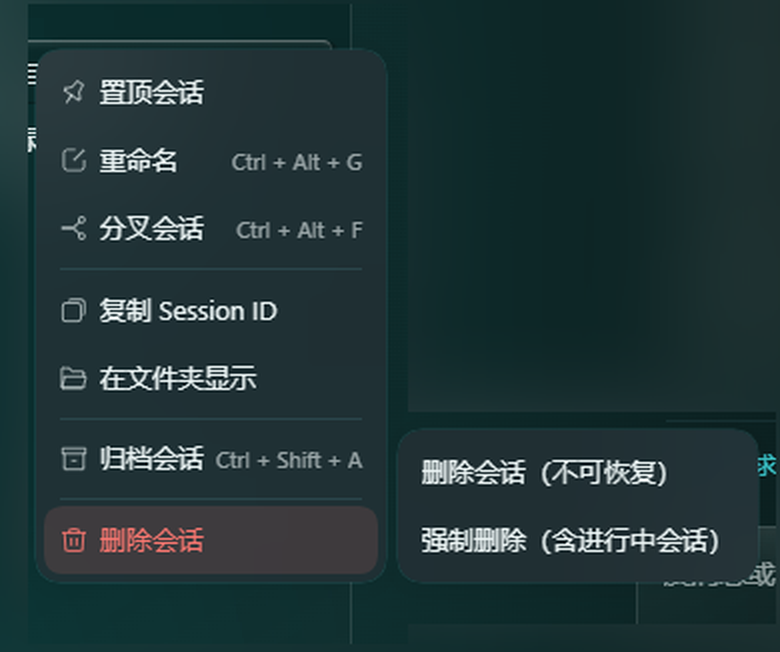
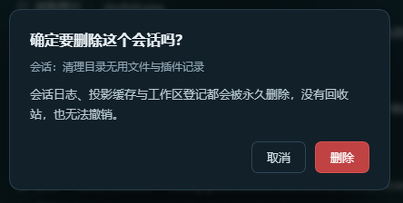

# dsh-session-purger

彻底删除 DSH 会话 —— 右键左侧会话列表中的任意一条，即可把该会话从磁盘上真正删掉。

A DSH plugin that permanently deletes session records (logs, projection cache, workspace registration) from the sidebar context menu.

## 用法 / Usage

1. 刷新一次 Web GUI 页面（让客户端包加载）。
2. 在左侧会话列表上**右键**任意会话 → 「删除会话」。
3. 选择：
   - **删除会话（不可恢复）** —— 删除不在使用中的会话；
   - **强制删除（含进行中会话）** —— 连正在打开的那个会话一起删（删完当前页面会失联，请自行切换或重开）。
4. 弹出二次确认对话框，点「删除」才真正执行；点「取消」、按 `Esc` 或点空白处都会中止（不会发出任何请求）。

删除成功后侧栏立即消失，输入框的 `@` 候选也会同步消失（两者都来自同一份会话存储列表）。




## 它到底删了什么 / What it deletes

| 位置 | 内容 |
| --- | --- |
| `~/.dsh/sessions/<项目目录>/<sessionId>/` | 会话日志 `session.v4.jsonl.zstd`（整个目录递归删除） |
| `~/.dsh/storages/session_projcache/sessions/<sessionId>.json` | 标题 / 统计等投影缓存 |
| `~/.dsh/storages/workspace.json` | 从工作区 `sessionIds` 摘除，并清除归档 / 固定标记 |

## 安全说明 / Safety

- 删除**不可恢复**，没有回收站。重要会话请先备份 `~/.dsh/sessions/` 下对应目录。
- 当前正在进行的会话默认不能删（接口返回 `409 in-use`），要么先切到别的会话，要么用「强制删除」。
- 宿主侧接口：`POST /dsh-session-purger/delete`，body `{"id": "<sessionId>", "force": false}`；`GET /dsh-session-purger/list` 列出可删除的会话。

## 安装 / Install

从本地目录安装：

```sh
dsh plugin --profile desktop add file:<path-to-this-repo>
```

或从 GitHub 安装：

```sh
dsh plugin --profile desktop add github:595708049/dsh-session-purger
```

装好后重启 DSH 或重载插件，然后刷新页面。

> 本地 `file:` 依赖是**文件复制**而非符号链接，改完源码要把文件同步到
> `~/.dsh/profiles/desktop/node_modules/dsh-session-purger/` 再重载插件。

## 开发备注

- 宿主入口 `index.js`：注册 `webServer` exact 路由。注册是**幂等**的（先查 `server.exact` 再 mount），因为桌面端禁用插件时不会卸载已注册的路由，重复注册会抛 `webserver: duplicate exact route` 导致整个插件条目不激活。
- 浏览器入口 `client.js`：`window.__ModuleLoader__.load({ id, factory })` 外壳，通过 `contextMenus.register({ target: 'session' })` 挂右键菜单，子菜单两项（确认 / 强制），父项图标通过 keyed slot `contextMenu.icon` 注册（key `dsh-session-purger.delete`）。
- 二次确认框是自己画的 DOM 模态框（`confirmDialog()`，z-index `2147483000`），因为客户端插件 API 没有 `dialog` / `confirm` 服务；取消走 `Esc`、点背景、点「取消」三条路径，全部在发出请求之前返回。
- 删除顺序很重要：**先**把 sessionId 从 workspace 摘除，**再**删日志目录 —— `workspace.sessionIds` 会按 `candidateMatches` 过滤，目录一删就无法再匹配，detach 会变成空操作。

## License

MIT
